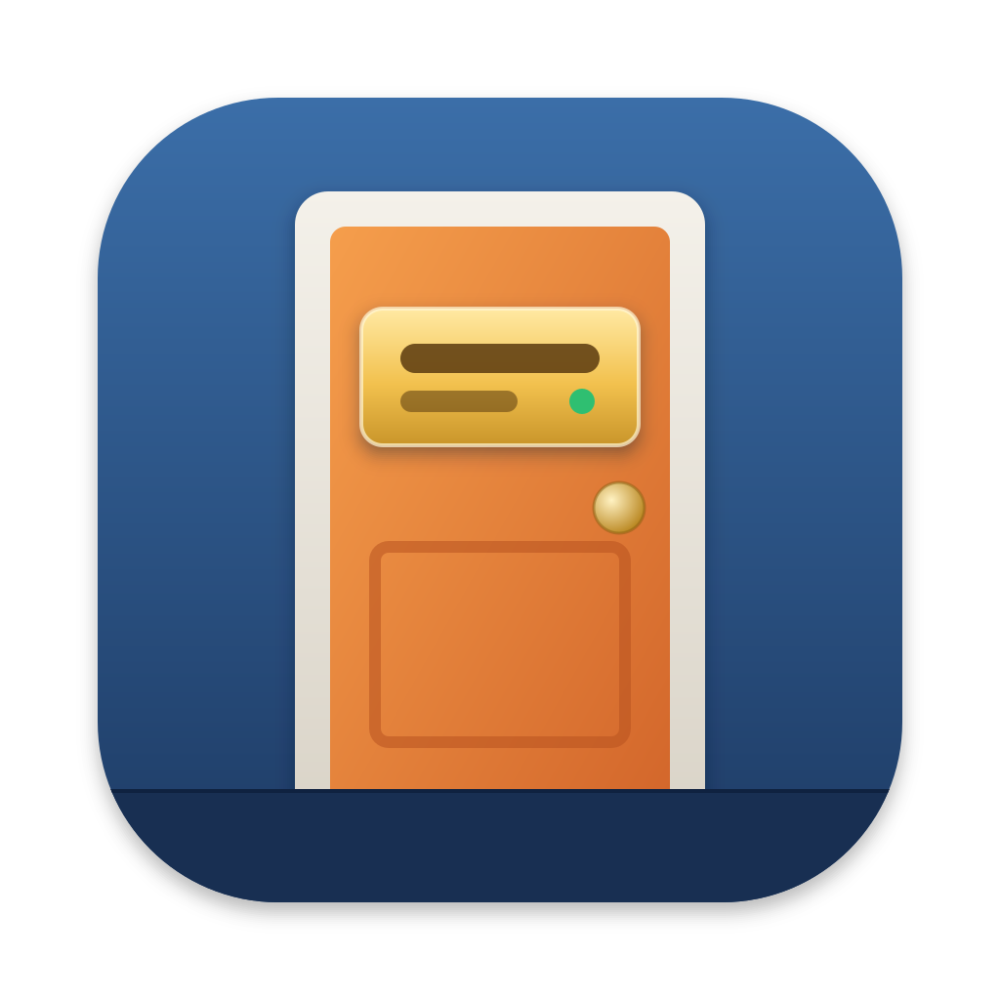
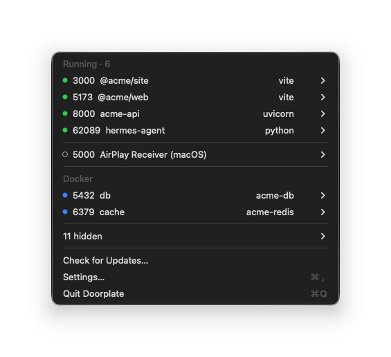
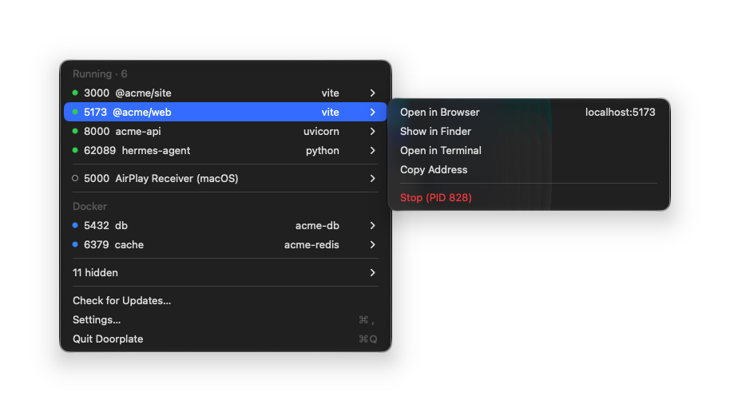
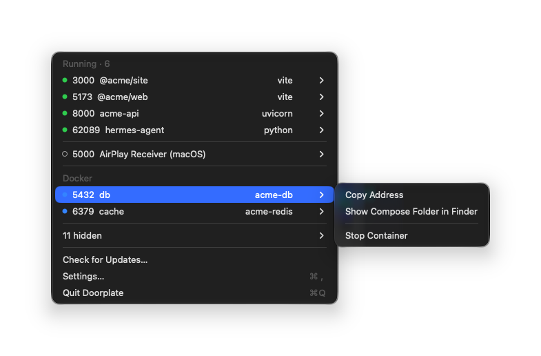

<div align="center">



# Doorplate

**すべてのポートに、プロジェクトの表札を。**

Doorplate は、接続を待ち受けている各ポートがどのプロジェクトのものかを表示する macOS メニューバーアプリです。
`lsof -i :3000` で pid を調べてサーバを推測する代わりに、メニューを開けば
`5173  @acme/web  vite` と表示されます。

[](https://github.com/junjuny0227/Doorplate/releases/latest)
[](https://github.com/junjuny0227/Doorplate/actions/workflows/ci.yml)
[](LICENSE)

[**ダウンロード**](https://github.com/junjuny0227/Doorplate/releases/latest) · [English](README.md) · [한국어](README.ko.md) · [简体中文](README.zh-Hans.md) · [Homebrew](#インストール) · [設計ドキュメント（韓国語）](docs/specs/2026-11-04-doorplate-mvp-design.md)



</div>

## できること

- **各サーバに名前を付けます。** 待ち受けポートごとに、実行元のプロジェクト名
  （`package.json`、`Cargo.toml`、`pyproject.toml`、Gradle、Maven、`go.mod`、`.git` フォルダから取得）と、
  起動したツールを表示します。JVM やモノレポのサーバにも対応しています。
- **Docker Compose に対応しています。** コンテナの公開ポートを Compose サービス名で表示し、
  右側にコンテナ名を添えます。Docker Desktop、OrbStack、Colima で使えます。
- **不要な情報を隠します。** IDE、ビルドデーモン、ほかのアプリは、設定で表示を選ぶまで非表示です。
  ソケットを共有するワーカープロセスは 1 行にまとめ、デバッガ、インスペクタ、LiveReload のポートは
  そのサーバの下にまとめます。
- **macOS 自体のポートも説明します。** AirPlay などの macOS サービスは既定で非表示リストに入り、
  設定の **システムポートを表示** をオンにすると専用の区画に表示されます。
  5000 と 7000 の AirPlay レシーバーには、オフにできる設定の場所も案内します。
- **行から操作できます。** ブラウザで開く、Finder に表示、その場所をターミナルで開く、
  アドレスをコピー、サーバを終了。⌥ を押すと、行がワンクリックで終了できる項目に変わります。
- **慎重に終了します。** 終了前に確認し、SIGTERM を送ります。10 秒後も実行中なら、待機を続けるか
  強制終了するかを選べます。コンテナは Docker API で停止し、Docker 自体は終了しません。
- **表示を更新し続けます。** メニューを開いている間も一覧が更新され、長時間実行中のサーバは
  オレンジ色（`· 3d`）で示されます。
- **アプリ自体を更新できます。** 署名済みアップデート（Sparkle）を使います。
- **複数の言語に対応しています。** English、한국어、日本語、简体中文。

## 画面で見る

<table>
  <tr>
    <td width="50%">
      
      <p align="center"><b>サーバ</b>：行から開く、コピー、終了</p>
    </td>
    <td width="50%">
      
      <p align="center"><b>Docker</b>：Compose サービスを名前で表示</p>
    </td>
  </tr>
</table>

## 検出できるもの

| スタック | サーバ |
| --- | --- |
| Node | vite, next, nuxt, astro, remix, webpack |
| JVM | `gradle bootRun`、`mvn spring-boot:run`、`java -jar`、IntelliJ の実行構成。Gradle と Kotlin のデーモンは非表示にし、JDWP デバッガのポートはサーバの下にまとめます |
| Rust | `cargo run`、`target/debug` または `target/release` 内のバイナリ |
| Python | Django（`manage.py runserver`）、uvicorn、Flask、gunicorn |
| Ruby | Rails, puma |
| Docker | 実行中のコンテナの公開ポートを Compose サービス名で表示 |

作業ディレクトリから親にたどって最初に見つかるプロジェクトの目印を使って、サーバに名前を付けます。
見つからなければ、フォルダ名を使います。

## 基本方針

- **ローカルで完結します。** Mac のプロセスとソケットの情報を読み取り、Docker とはローカルの
  unix ソケット経由でのみ通信します。各ポートに接続することはありません。
- **管理者権限は不要です。** `sudo` もヘルパーツールも使いません。
- **ネットワーク通信はアップデートのみです。** Mac の情報を外部に送りません。通信は GitHub Pages の
  appcast（`https://junjuny0227.github.io/Doorplate/appcast.xml`）へのアップデート確認のみです。
  自動確認は設定で無効にできます。テレメトリや利用統計は収集しません。

## インストール

macOS 14 以降（Apple silicon および Intel）が必要です。

```sh
brew install --cask junjuny0227/tap/doorplate
```

または [リリース](https://github.com/junjuny0227/Doorplate/releases/latest)から
`Doorplate-<version>.zip` をダウンロードして展開し、隣にある `.sha256` ファイルで検証してください。

### 初回起動

Doorplate は ad-hoc 署名で、Apple の公証を受けていないため、macOS が初回起動をブロックします。
macOS 15 以降では、右クリック → 開くでは回避できません。

1. 開く前に、Finder で `Doorplate.app` をアプリケーションフォルダ（`/Applications`）に移動します。
   ダウンロードした場所で開くと、macOS が一時的な場所から実行するため（App Translocation）、
   Doorplate が自身をアップデートできません。Homebrew ではこの移動が自動で行われます。
2. アプリを開くと、macOS が「“Doorplate.app”は開かれませんでした」
   （「“Doorplate.app”にMacに損害を与えたり、プライバシーを侵害する可能性のあるマルウェアが
   含まれていないことをAppleは検証できませんでした。」）と表示します。**完了**をクリックします。
   **ゴミ箱に入れる**はクリックしないでください。アプリがゴミ箱に移動されます。
3. **システム設定 › プライバシーとセキュリティ**を開き、Doorplate の案内の横にある
   **このまま開く**をクリックします。パスワードまたは Touch ID で確認し、表示されるダイアログで
   もう一度**このまま開く**をクリックします。

ターミナルに慣れている場合は、手順 2–3 の代わりに次を実行できます。

```sh
xattr -dr com.apple.quarantine /Applications/Doorplate.app
```

これは、インターネットからダウンロードしたファイルに macOS が付ける隔離フラグを削除するため、
Gatekeeper がアプリをブロックしなくなります。

### フォルダへのアクセス

プロジェクト名を表示するため、Doorplate は `package.json` などのファイルを読み取ります。
プロジェクトが `~/Documents`、`~/Desktop`、`~/Downloads`、iCloud Drive にある場合、macOS が
そのフォルダへのアクセスを許可するか確認します（「Doorplateは、各ポートがどのプロジェクトのものかを
表示するために、package.jsonなどのプロジェクトファイルを読み取ります。」）。許可しない場合は、
フォルダ名で表示します。Doorplate は ad-hoc 署名のため、アップデート後は保護されたフォルダごとに
一度ずつ、再び確認が表示されます。

### アップデート

Doorplate は 1 日に一度アップデートを確認します。今すぐ確認するには、メニューの
**アップデートを確認…**を選びます。アップデートは、インストール前に Doorplate のアップデート署名鍵で
検証します。Homebrew cask は更新をアプリに任せるため（`auto_updates`）、通常の `brew upgrade` では
スキップされます。`brew upgrade --cask --greedy doorplate` では Homebrew 経由で再インストールします。

## ソースからビルド

Xcode と [XcodeGen](https://github.com/yonaskolb/XcodeGen) が必要です。

```sh
brew install xcodegen
xcodegen generate
xcodebuild -project Doorplate.xcodeproj -scheme Doorplate -configuration Debug -derivedDataPath build CODE_SIGN_IDENTITY=- build
```

アプリは `build/Build/Products/Debug/Doorplate.app` に生成されます。スキャナは
`Packages/DoorplateCore` にあり、UI に依存しません。

```sh
swift test --package-path Packages/DoorplateCore
swift run --package-path Packages/DoorplateCore doorplate-scan
```

`doorplate-scan` は、この Mac で Doorplate が検出した内容を JSON で出力します。読み取りのみです。

## ドキュメント

- [MVP 設計](docs/specs/2026-11-04-doorplate-mvp-design.md)（韓国語）
- [実装計画](docs/plans/)（韓国語）
- [手動確認](docs/checklists/manual.md)と[リリースチェックリスト](docs/checklists/release.md)（韓国語）

## ライセンス

[Apache-2.0](LICENSE)。
