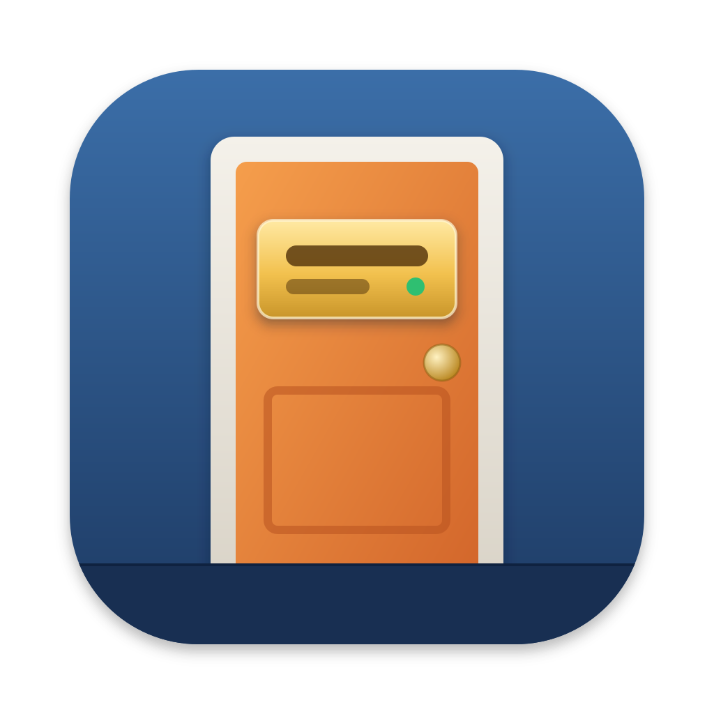
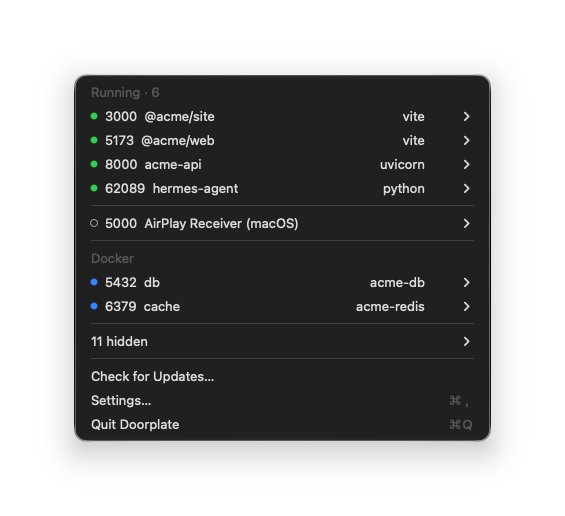
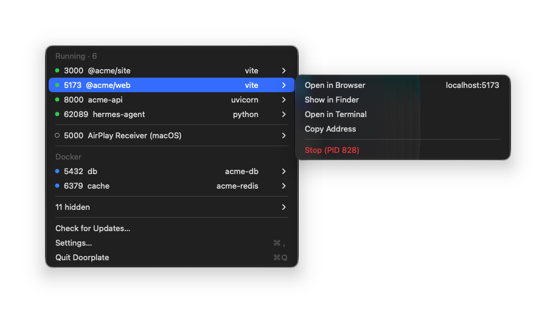
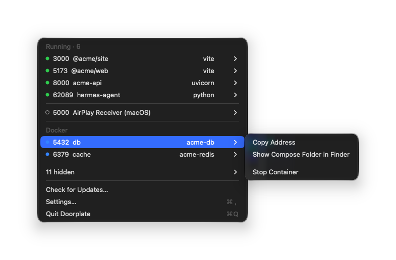

<div align="center">



# Doorplate

**포트마다 문패를 달아 드립니다.**

Doorplate는 열려 있는 포트마다 어느 프로젝트의 서버인지 보여 주는 macOS 메뉴바
앱입니다. `lsof -i :3000`으로 pid를 찾고 어느 서버인지 짐작하는 대신, 메뉴를 열면
`5173  @acme/web  vite`처럼 보입니다.

[](https://github.com/junjuny0227/Doorplate/releases/latest)
[](https://github.com/junjuny0227/Doorplate/actions/workflows/ci.yml)
[](LICENSE)

[**다운로드**](https://github.com/junjuny0227/Doorplate/releases/latest) · [English](README.md) · [Homebrew](#설치) · [설계 문서](docs/specs/2026-11-04-doorplate-mvp-design.md)



</div>

## 하는 일

- **서버마다 이름을 붙입니다.** 열린 포트마다 서버가 실행된 프로젝트의 이름
  (`package.json`, `Cargo.toml`, `pyproject.toml`, Gradle, Maven, `go.mod`, `.git`
  폴더)과 서버를 띄운 도구를 보여 줍니다. JVM과 모노레포 서버도 정확하게 붙입니다.
- **Docker Compose를 알아봅니다.** 컨테이너가 게시한 포트를 Compose 서비스 이름으로
  보여 주고, 오른쪽에 컨테이너 이름을 둡니다. Docker Desktop, OrbStack, Colima에서
  동작합니다.
- **필요 없는 것은 숨깁니다.** IDE, 빌드 데몬, 다른 앱은 설정에서 켜기 전까지
  숨깁니다. 소켓을 나눠 쓰는 worker 프로세스는 한 행으로, 디버거·inspector·LiveReload
  포트는 해당 서버 아래에 묶습니다.
- **macOS 자체 포트도 알려 줍니다.** 5000·7000번의 AirPlay 수신은 따로 한 행으로
  보여 주고, 끄는 곳을 안내합니다.
- **행에서 바로 다룹니다.** 브라우저에서 열기, Finder에서 보기, 그 폴더에서 터미널
  열기, 주소 복사, 서버 종료. ⌥를 누르고 있으면 행이 바로 종료하는 항목으로 바뀝니다.
- **조심해서 종료합니다.** 종료 전에 확인을 받고 SIGTERM을 보냅니다. 10초가 지나도
  서버가 살아 있으면 기다릴지 강제 종료할지 묻습니다. 컨테이너는 Docker API로
  정지하고, Docker 자체는 종료하지 않습니다.
- **실시간으로 바뀝니다.** 메뉴를 연 채로도 목록이 갱신되고, 오래 켜진 서버는 주황
  글자(`· 3일째`)로 표시합니다.
- **스스로 업데이트합니다.** 서명된 업데이트를 받습니다(Sparkle).
- **한국어와 영어**를 지원합니다.

## 자세히 보기

<table>
  <tr>
    <td width="50%">
      
      <p align="center"><b>서버</b>: 행에서 열기, 복사, 종료</p>
    </td>
    <td width="50%">
      
      <p align="center"><b>Docker</b>: Compose 서비스 이름으로</p>
    </td>
  </tr>
</table>

## 무엇을 알아보나

| 스택 | 서버 |
| --- | --- |
| Node | vite, next, nuxt, astro, remix, webpack |
| JVM | `gradle bootRun`, `mvn spring-boot:run`, `java -jar`, IntelliJ 실행 구성. Gradle·Kotlin 데몬은 숨기고, JDWP 디버거 포트는 해당 서버 아래에 묶습니다 |
| Rust | `cargo run`, `target/debug`·`target/release` 아래의 실행 파일 |
| Python | Django(`manage.py runserver`), uvicorn, Flask, gunicorn |
| Ruby | Rails, puma |
| Docker | 실행 중인 컨테이너가 게시한 포트, Compose 서비스 이름으로 |

서버 이름은 작업 폴더에서 위로 올라가며 가장 가까운 프로젝트 표식에서 가져옵니다.
표식이 없으면 폴더 이름을 씁니다.

## 원칙

- **로컬 전용.** 프로세스와 소켓 정보는 Mac 안에서만 읽고, Docker와는 로컬 unix
  소켓으로만 통신합니다. 포트에 접속해 확인하지 않습니다.
- **관리자 권한 없음.** `sudo`도, 별도 도우미 도구도 쓰지 않습니다.
- **네트워크는 업데이트 확인뿐.** Mac 밖으로 보내는 정보는 없습니다. 요청은 GitHub
  Pages의 appcast(`https://junjuny0227.github.io/Doorplate/appcast.xml`)로 하는
  업데이트 확인 하나이고, 자동 확인은 설정에서 끌 수 있습니다. 사용 통계를 모으지
  않습니다.

## 설치

macOS 14 이상(Apple silicon, Intel)이 필요합니다.

```sh
brew install --cask junjuny0227/tap/doorplate
```

또는 [Releases](https://github.com/junjuny0227/Doorplate/releases/latest)에서
`Doorplate-<버전>.zip`을 받아 압축을 풀고, 옆의 `.sha256` 파일로 체크섬을 확인합니다.

### 처음 열 때

Doorplate는 ad-hoc 서명만 했고 Apple 공증을 받지 않았으므로, macOS가 첫 실행을
막습니다. macOS 15부터는 우클릭 → 열기로 넘어갈 수 없습니다.

1. 처음 열기 전에 Finder에서 `Doorplate.app`을 응용 프로그램 폴더(`/Applications`)로
   옮깁니다. 다운로드한 자리에서 열면 macOS가 앱을 임시 위치(App Translocation)에서
   실행해, Doorplate가 스스로 업데이트하지 못합니다. Homebrew는 이 단계를 대신 해
   줍니다.
2. 앱을 엽니다. "'Doorplate.app'을(를) 열지 않음" 창("Apple은 'Doorplate.app'에
   사용자의 Mac에 손상을 입히거나 사용자의 개인 정보에 침입할 수 있는 악성 코드가
   없음을 확인할 수 없습니다.")이 뜹니다. **완료**를 누릅니다. **휴지통으로 이동**은
   누르지 않습니다. 앱이 휴지통으로 옮겨집니다.
3. **시스템 설정 › 개인정보 보호 및 보안**에서 Doorplate 안내 옆의 **그래도 열기**를
   누르고 암호나 Touch ID로 확인한 뒤, 다시 뜨는 창에서 **그래도 열기**를 누릅니다.

터미널에 익숙하다면 2–3단계 대신 다음 명령을 쓸 수 있습니다.

```sh
xattr -dr com.apple.quarantine /Applications/Doorplate.app
```

이 명령은 인터넷에서 받은 파일에 macOS가 붙이는 다운로드 격리 표시를 지웁니다.
그러면 Gatekeeper가 앱을 막지 않습니다.

### 폴더 접근

프로젝트 이름을 보여 주려고 `package.json` 같은 파일을 읽습니다. 프로젝트가
`~/Documents`, `~/Desktop`, `~/Downloads`, iCloud Drive에 있으면 macOS가 그 폴더에
접근해도 되는지 묻습니다("Doorplate는 각 포트가 어느 프로젝트의 것인지 보여 주려고
package.json 같은 프로젝트 파일을 읽습니다."). 거부하면 그 서버는 폴더 이름으로
보입니다. Doorplate는 ad-hoc 서명이라, 업데이트할 때마다 보호 폴더별로 한 번씩 다시
묻습니다.

### 업데이트

하루에 한 번 업데이트를 확인합니다. 바로 확인하려면 메뉴에서 **업데이트 확인…**을
누릅니다. 업데이트는 설치 전에 Doorplate의 업데이트 서명 키로 검증합니다. Homebrew
cask는 업데이트를 앱에 맡기므로(`auto_updates`) 일반 `brew upgrade`는 건너뜁니다.
Homebrew로 다시 설치하려면 `brew upgrade --cask --greedy doorplate`를 씁니다.

## 소스에서 빌드

Xcode와 [XcodeGen](https://github.com/yonaskolb/XcodeGen)이 필요합니다.

```sh
brew install xcodegen
xcodegen generate
xcodebuild -project Doorplate.xcodeproj -scheme Doorplate -configuration Debug -derivedDataPath build CODE_SIGN_IDENTITY=- build
```

앱은 `build/Build/Products/Debug/Doorplate.app`에 생깁니다. 스캐너는
`Packages/DoorplateCore`에 있고 UI에 의존하지 않습니다.

```sh
swift test --package-path Packages/DoorplateCore
swift run --package-path Packages/DoorplateCore doorplate-scan
```

`doorplate-scan`은 이 Mac에서 Doorplate가 보는 내용을 JSON으로 출력합니다. 읽기만
합니다.

## 문서

- [MVP 설계](docs/specs/2026-11-04-doorplate-mvp-design.md)
- [구현 계획](docs/plans/)
- [수동 점검표](docs/checklists/manual.md), [릴리스 체크리스트](docs/checklists/release.md)

## 라이선스

[Apache-2.0](LICENSE).
