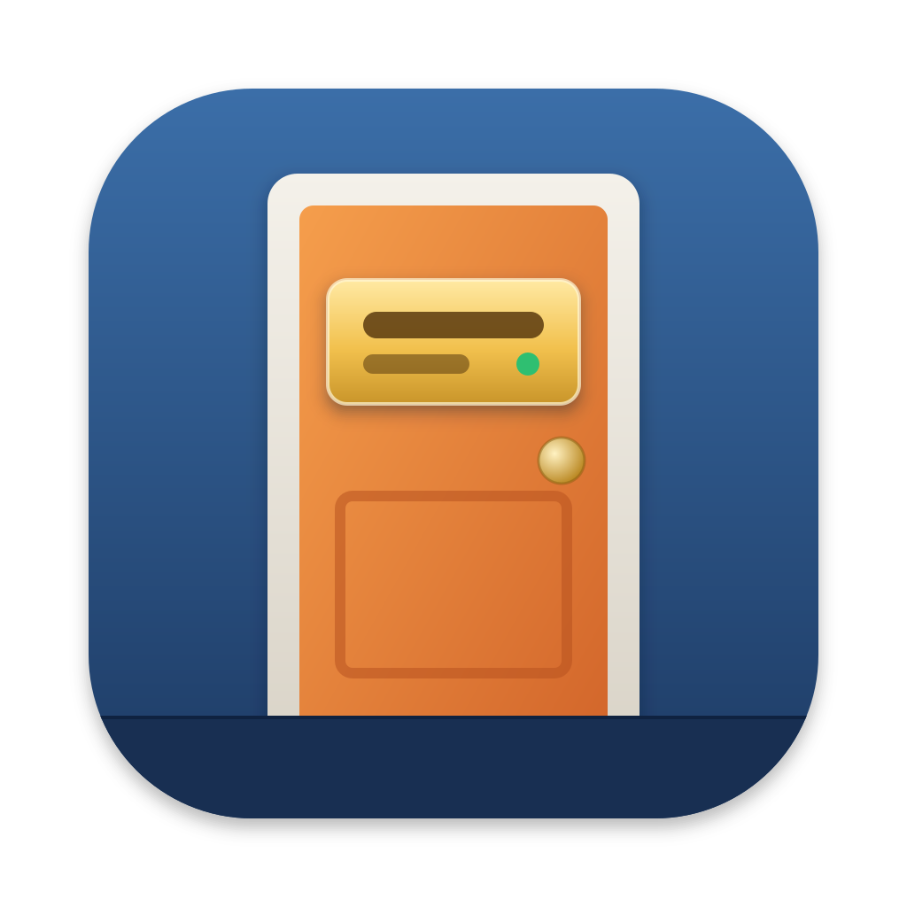
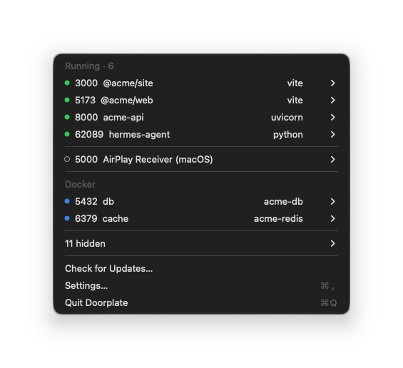
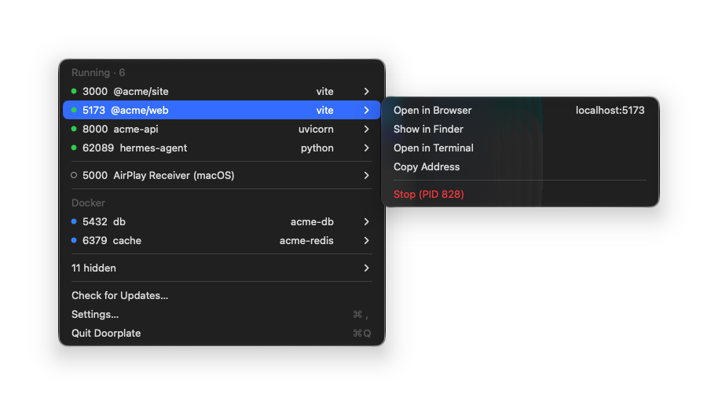
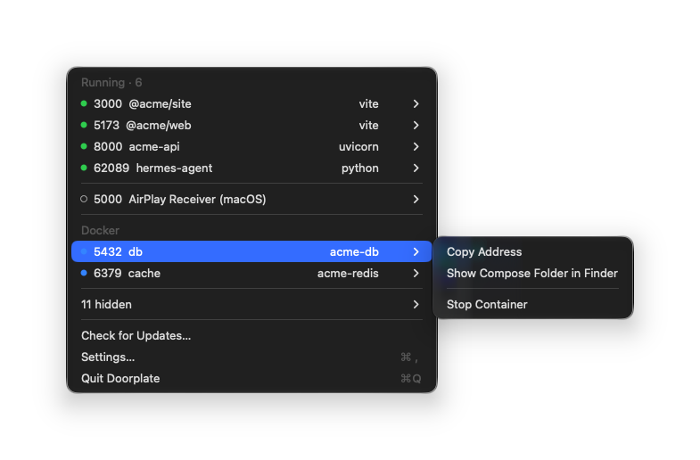

<div align="center">



# Doorplate

**A nameplate on every port's door.**

Doorplate is a macOS menu bar app that shows which project each listening port
belongs to. Instead of running `lsof -i :3000` and guessing which server owns the pid,
open the menu and read `5173  @acme/web  vite`.

[](https://github.com/junjuny0227/Doorplate/releases/latest)
[](https://github.com/junjuny0227/Doorplate/actions/workflows/ci.yml)
[](LICENSE)

[**Download**](https://github.com/junjuny0227/Doorplate/releases/latest) · [한국어](README.ko.md) · [日本語](README.ja.md) · [简体中文](README.zh-Hans.md) · [Homebrew](#install) · [Design (Korean)](docs/specs/2026-11-04-doorplate-mvp-design.md)



</div>

## What it does

- **Names every server.** Each listening port gets the name of the project it runs
  from (`package.json`, `Cargo.toml`, `pyproject.toml`, Gradle, Maven, `go.mod` or a
  `.git` folder) and the tool that started it. JVM and monorepo servers too.
- **Understands Docker Compose.** Published container ports show the Compose service
  name, with the container name on the right. Works with Docker Desktop, OrbStack and
  Colima.
- **Hides the noise.** IDEs, build daemons and other apps stay hidden until you choose
  to show them in Settings. Worker processes that share a socket appear as one row;
  debugger, inspector and LiveReload ports are grouped under their server.
- **Explains macOS's own ports.** Turn on **Show system ports** in Settings to see
  AirPlay and other macOS services. They stay in the hidden list by default. AirPlay
  Receiver on 5000 and 7000 includes instructions for turning it off.
- **Acts on a row.** Open in the browser, show in Finder, open a terminal there, copy
  the address, or stop the server. Hold ⌥ to turn a row into a one-click Stop item.
- **Stops carefully.** Stop asks first and sends SIGTERM. If the server is still
  running ten seconds later, Doorplate offers to wait or force stop. Containers stop
  through the Docker API; Docker itself is never stopped.
- **Stays live.** The list updates while the menu is open, and servers running for a
  long time are marked in orange (`· 3d`).
- **Updates itself** with signed updates (Sparkle).
- **Speaks** English, 한국어, 日本語 and 简体中文.

## A closer look

<table>
  <tr>
    <td width="50%">
      
      <p align="center"><b>Servers</b>: open, copy or stop from the row</p>
    </td>
    <td width="50%">
      
      <p align="center"><b>Docker</b>: Compose services by name</p>
    </td>
  </tr>
</table>

## What it recognizes

| Stack | Servers |
| --- | --- |
| Node | vite, next, nuxt, astro, remix, webpack |
| JVM | `gradle bootRun`, `mvn spring-boot:run`, `java -jar`, IntelliJ run configurations. Gradle and Kotlin daemons are hidden; JDWP debugger ports are grouped under their server |
| Rust | `cargo run`, binaries under `target/debug` or `target/release` |
| Python | Django (`manage.py runserver`), uvicorn, Flask, gunicorn |
| Ruby | Rails, puma |
| Docker | Published ports of running containers, by Compose service name |

A server is named after the nearest project marker above its working directory. When
there is none, Doorplate uses the folder name.

## Principles

- **Local only.** Doorplate reads process and socket information on your Mac and talks
  to Docker only through its local unix socket. It never connects to your ports.
- **No administrator rights.** No `sudo`, no helper tools.
- **Network only for updates.** Nothing leaves your Mac. The one request is the update
  check against the appcast on GitHub Pages
  (`https://junjuny0227.github.io/Doorplate/appcast.xml`); automatic checks can be
  turned off in Settings. No telemetry or usage statistics.

## Install

Requires macOS 14 or later (Apple silicon and Intel).

```sh
brew install --cask junjuny0227/tap/doorplate
```

Or download `Doorplate-<version>.zip` from
[Releases](https://github.com/junjuny0227/Doorplate/releases/latest), unzip it, and
check it against the `.sha256` file next to it.

### First open

Doorplate is signed ad hoc and not notarized by Apple, so macOS blocks the first
launch. On macOS 15 and later, right-click → Open no longer gets past this.

1. Before opening it, move `Doorplate.app` to your Applications folder
   (`/Applications`) in Finder. If you open the app where it was downloaded, macOS runs
   it from a temporary location (App Translocation) and Doorplate cannot update itself.
   Homebrew does this for you.
2. Open the app. macOS shows "“Doorplate.app” Not Opened" ("Apple could not verify
   “Doorplate.app” is free of malware that may harm your Mac or compromise your
   privacy."). Click **Done**. Do not click **Move to Trash**: it moves the app to the
   Trash.
3. Open **System Settings › Privacy & Security**, click **Open Anyway** next to the
   message about Doorplate, confirm with your password or Touch ID, then click **Open
   Anyway** in the dialog that appears.

If you are comfortable with Terminal, you can run this instead of steps 2–3:

```sh
xattr -dr com.apple.quarantine /Applications/Doorplate.app
```

This removes the download quarantine flag that macOS adds to files from the internet,
so Gatekeeper no longer stops the app.

### Folder access

To show a project's name, Doorplate reads files such as `package.json`. If your
projects live in `~/Documents`, `~/Desktop`, `~/Downloads` or iCloud Drive, macOS asks
whether Doorplate may access that folder ("Doorplate reads project files such as
package.json to show which project owns each port."). If you deny it, those servers
are named after their folder instead. Because Doorplate is signed ad hoc, macOS asks
again once per protected folder after each update.

### Updates

Doorplate checks for updates once a day; choose **Check for Updates…** in the menu to
check now. An update is verified against Doorplate's update signing key before it is
installed. The Homebrew cask leaves updates to the app (`auto_updates`), so plain
`brew upgrade` skips it; `brew upgrade --cask --greedy doorplate` reinstalls it through
Homebrew.

## Build from source

Requires Xcode and [XcodeGen](https://github.com/yonaskolb/XcodeGen).

```sh
brew install xcodegen
xcodegen generate
xcodebuild -project Doorplate.xcodeproj -scheme Doorplate -configuration Debug -derivedDataPath build CODE_SIGN_IDENTITY=- build
```

The app is at `build/Build/Products/Debug/Doorplate.app`. The scanner lives in
`Packages/DoorplateCore` and has no UI dependencies:

```sh
swift test --package-path Packages/DoorplateCore
swift run --package-path Packages/DoorplateCore doorplate-scan
```

`doorplate-scan` prints what Doorplate sees on this Mac as JSON. It only reads.

## Docs

- [MVP design](docs/specs/2026-11-04-doorplate-mvp-design.md) (Korean)
- [Implementation plans](docs/plans/) (Korean)
- [Manual checks](docs/checklists/manual.md) and [release checklist](docs/checklists/release.md) (Korean)

## License

[Apache-2.0](LICENSE).
