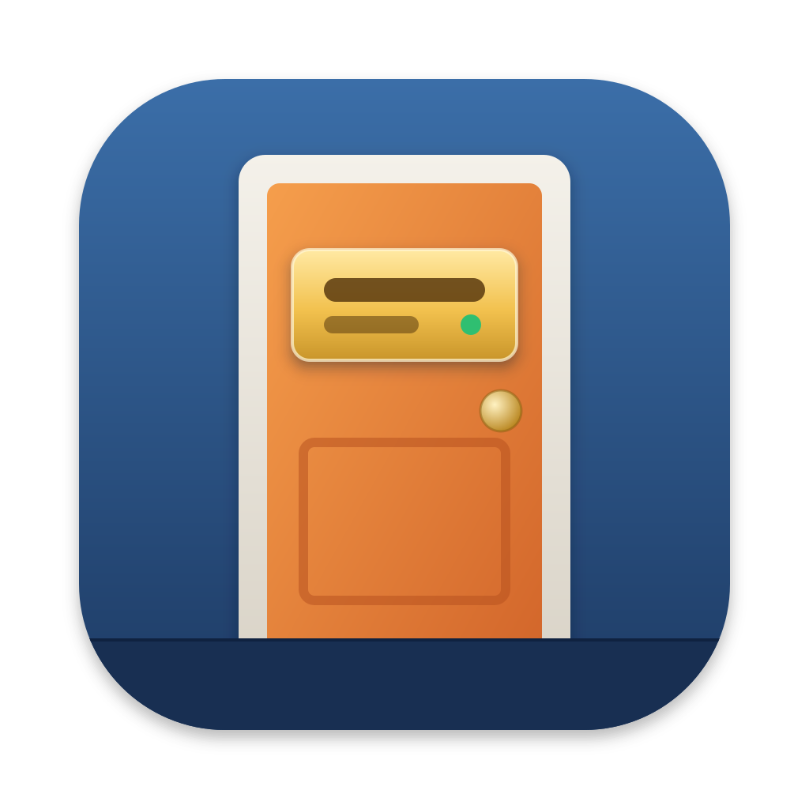
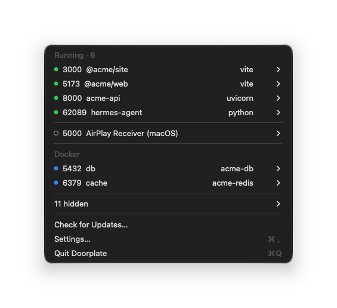
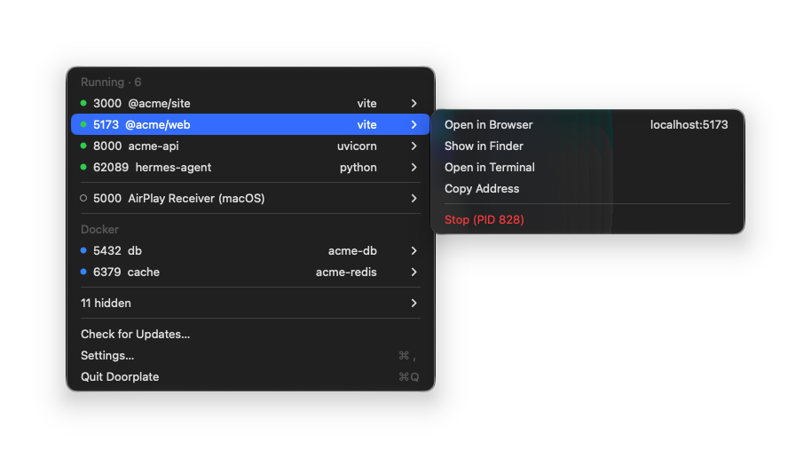
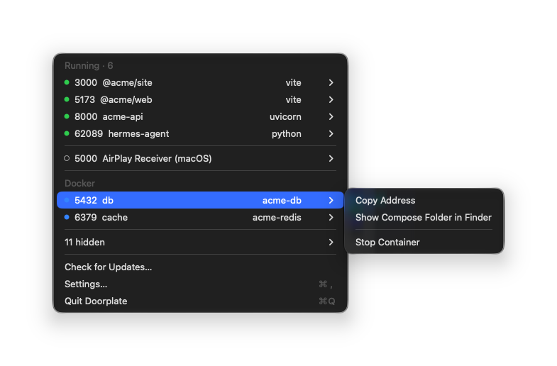

<div align="center">



# Doorplate

**为每个端口挂上项目的门牌。**

Doorplate 是一款 macOS 菜单栏应用，显示每个监听端口属于哪个项目。
无需运行 `lsof -i :3000` 查找 pid，再猜测它属于哪个服务器；打开菜单就能看到
`5173  @acme/web  vite`。

[](https://github.com/junjuny0227/Doorplate/releases/latest)
[](https://github.com/junjuny0227/Doorplate/actions/workflows/ci.yml)
[](LICENSE)

[**下载**](https://github.com/junjuny0227/Doorplate/releases/latest) · [English](README.md) · [한국어](README.ko.md) · [日本語](README.ja.md) · [Homebrew](#安装) · [设计文档（韩语）](docs/specs/2026-11-04-doorplate-mvp-design.md)



</div>

## 功能

- **为每个服务器显示名称。** 为每个监听端口显示运行它的项目名称
  （从 `package.json`、`Cargo.toml`、`pyproject.toml`、Gradle、Maven、`go.mod` 或 `.git` 文件夹获取），
  以及启动它的工具。也支持 JVM 和单仓库中的服务器。
- **支持 Docker Compose。** 容器的发布端口显示为 Compose 服务名称，右侧显示容器名称。
  可与 Docker Desktop、OrbStack 和 Colima 配合使用。
- **隐藏干扰项。** IDE、构建守护进程和其他应用默认隐藏，直到你在设置中选择显示。
  共享同一套接字的工作进程合并为一行；调试器、检查器和 LiveReload 端口归到所属服务器下。
- **解释 macOS 自身的端口。** 5000 和 7000 上的 AirPlay 接收器单独显示，并说明在哪里关闭。
- **直接从行内操作。** 在浏览器中打开、在 Finder 中显示、在该位置打开终端、拷贝地址或退出服务器。
  按住 ⌥，即可把一行变成单击退出的菜单项。
- **谨慎退出。** 退出前先征求确认，然后发送 SIGTERM。如果十秒后仍在运行，Doorplate 会让你选择
  继续等待或强制退出。容器通过 Docker API 停止，绝不会退出 Docker 本身。
- **持续更新。** 菜单打开时列表也会更新，长时间运行的服务器用橙色标记（`· 3d`）。
- **应用内更新。** 使用经过签名的更新（Sparkle）。
- **支持多种语言**：English、한국어、日本語 和 简体中文。

## 界面一览

<table>
  <tr>
    <td width="50%">
      
      <p align="center"><b>服务器</b>：从行内打开、拷贝或退出</p>
    </td>
    <td width="50%">
      
      <p align="center"><b>Docker</b>：按名称显示 Compose 服务</p>
    </td>
  </tr>
</table>

## 可识别的内容

| 技术栈 | 服务器 |
| --- | --- |
| Node | vite, next, nuxt, astro, remix, webpack |
| JVM | `gradle bootRun`、`mvn spring-boot:run`、`java -jar`、IntelliJ 运行配置。隐藏 Gradle 和 Kotlin 守护进程，将 JDWP 调试器端口归到所属服务器下 |
| Rust | `cargo run`、`target/debug` 或 `target/release` 下的二进制文件 |
| Python | Django（`manage.py runserver`）、uvicorn、Flask、gunicorn |
| Ruby | Rails, puma |
| Docker | 正在运行的容器的发布端口，按 Compose 服务名称显示 |

从服务器的工作目录向上查找最近的项目标记，以此确定名称。没有项目标记时，Doorplate 使用文件夹名称。

## 原则

- **仅在本机运行。** Doorplate 读取 Mac 上的进程和套接字信息，只通过本地 unix 套接字与 Docker
  通信，绝不会连接你的端口。
- **无需管理员权限。** 不使用 `sudo`，也不使用辅助工具。
- **仅更新需要联网。** Mac 上的信息不会外传。唯一的请求是向 GitHub Pages 上的 appcast
  （`https://junjuny0227.github.io/Doorplate/appcast.xml`）检查更新；可在设置中关闭自动检查。
  不收集遥测数据或使用统计。

## 安装

需要 macOS 14 或更高版本（Apple silicon 和 Intel）。

```sh
brew install --cask junjuny0227/tap/doorplate
```

也可从[发布页面](https://github.com/junjuny0227/Doorplate/releases/latest)下载
`Doorplate-<version>.zip`，解压后使用旁边的 `.sha256` 文件校验。

### 首次打开

Doorplate 使用 ad-hoc 签名，尚未经过 Apple 公证，因此 macOS 会阻止首次启动。
在 macOS 15 及更高版本中，右键点按 → 打开已无法绕过检查。

1. 打开前，先在 Finder 中把 `Doorplate.app` 移到“应用程序”文件夹（`/Applications`）。
   如果直接从下载位置打开，macOS 会从临时位置运行它（App Translocation），导致 Doorplate 无法自行更新。
   通过 Homebrew 安装时会自动完成这一步。
2. 打开应用。macOS 会显示“未打开‘Doorplate.app’”
   （“Apple 无法验证‘Doorplate.app’是否包含可能危害 Mac 安全或泄漏隐私的恶意软件。”）。
   点按**完成**。请勿点按**移到废纸篓**，否则应用会被移到废纸篓。
3. 打开**系统设置 › 隐私与安全性**，在 Doorplate 提示旁点按**仍要打开**，
   使用密码或 Touch ID 确认，然后在弹出的对话框中再次点按**仍要打开**。

如果熟悉终端，可运行以下命令来代替第 2–3 步：

```sh
xattr -dr com.apple.quarantine /Applications/Doorplate.app
```

此命令会移除 macOS 为互联网下载文件添加的隔离标记，使 Gatekeeper 不再阻止该应用。

### 文件夹访问权限

为了显示项目名称，Doorplate 需要读取 `package.json` 等文件。如果项目位于 `~/Documents`、
`~/Desktop`、`~/Downloads` 或 iCloud Drive，macOS 会询问是否允许 Doorplate 访问该文件夹
（“Doorplate读取package.json等项目文件，以显示每个端口所属的项目。”）。拒绝后，这些服务器会改用
文件夹名称显示。由于 Doorplate 使用 ad-hoc 签名，每次更新后 macOS 都会针对每个受保护文件夹重新询问一次。

### 更新

Doorplate 每天检查一次更新；选择菜单中的**检查更新…**可立即检查。安装前会使用 Doorplate 的更新签名密钥
验证更新。Homebrew cask 将更新交给应用自身处理（`auto_updates`），因此普通的 `brew upgrade` 会跳过它；
`brew upgrade --cask --greedy doorplate` 则会通过 Homebrew 重新安装。

## 从源码构建

需要 Xcode 和 [XcodeGen](https://github.com/yonaskolb/XcodeGen)。

```sh
brew install xcodegen
xcodegen generate
xcodebuild -project Doorplate.xcodeproj -scheme Doorplate -configuration Debug -derivedDataPath build CODE_SIGN_IDENTITY=- build
```

应用位于 `build/Build/Products/Debug/Doorplate.app`。扫描器位于 `Packages/DoorplateCore`，不依赖 UI：

```sh
swift test --package-path Packages/DoorplateCore
swift run --package-path Packages/DoorplateCore doorplate-scan
```

`doorplate-scan` 以 JSON 输出 Doorplate 在这台 Mac 上检测到的内容，只进行读取。

## 文档

- [MVP 设计](docs/specs/2026-11-04-doorplate-mvp-design.md)（韩语）
- [实施计划](docs/plans/)（韩语）
- [手动检查](docs/checklists/manual.md)和[发布检查清单](docs/checklists/release.md)（韩语）

## 许可证

[Apache-2.0](LICENSE)。
